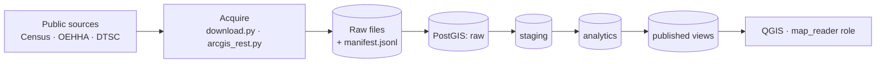
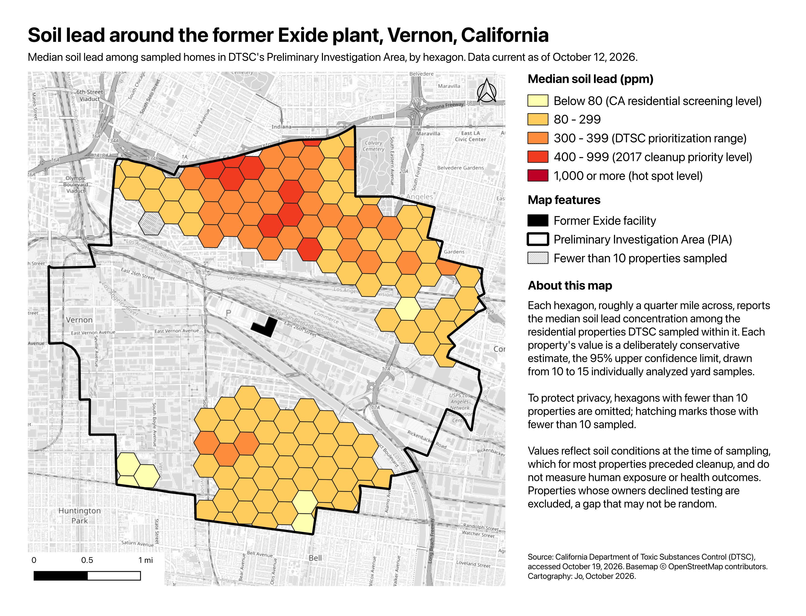

# Gateway Cities Environmental Data Pipeline

A reproducible geospatial data pipeline for studying lead contamination and cumulative environmental burden in Southeast Los Angeles, built around the former Exide battery recycling plant in Vernon, California.

## The question

**Where did the lead go, and what else do these neighborhoods carry?**

For nearly a century, a lead smelter in Vernon emitted lead into the surrounding neighborhoods. After the plant closed in 2015, California's Department of Toxic Substances Control (DTSC) sampled soil at thousands of homes within roughly 1.7 miles and began the largest residential cleanup of its kind in the state. Exide argued that soil lead tracks the age of homes and proximity to major roads more than proximity to the plant. That disagreement is a testable spatial question, and this project builds the data foundation to test it, alongside the region's other burdens: the I-710 freight corridor, industrial emitters, and the state's CalEnviroScreen scores.

## Status

Work in progress. Built so far:

- **Acquisition** from three public sources: Census TIGER/Line, OEHHA's CalEnviroScreen 5.0, and DTSC's ArcGIS feature services. Every download is checksummed, dated, and recorded in a provenance manifest.
- **A layered PostGIS database** (`raw` → `staging` → `analytics` → `published`) in which a read-only role can see only aggregated, privacy-protected views.
- **Privacy-safe aggregation** of 10,642 parcels into 200 m hexagons, with small-cell suppression.
- **A first map** of median soil lead by hexagon (see below).

## Architecture



## Privacy by design

The DTSC data describes real families' homes, so privacy is enforced at every layer rather than left to convention:

- **Parcel-level data never enters Git.** It's stored under `data/private/`, with `.gitignore` rules backed by a safety net that blocks spatial and tabular files anywhere in the repo.
- **Data minimization.** Addresses and document links are dropped at the staging layer; analysis uses only what it needs.
- **Database-enforced access.** The `map_reader` role can read only the `published` schema. Published views report hexagons with at least 10 parcels, and withhold statistics where fewer than 10 were sampled.
- **Verified, not assumed.** Access was tested from both `psql` and QGIS, which caught a client connection that had silently defaulted to the owner role.

## Early observations

Preliminary, and not yet tested statistically:

- All 14 census tracts in Huntington Park rank in the 89th–99th percentile statewide in CalEnviroScreen 5.0.
- In DTSC's parcel layer (as of October 12, 2026), 6,389 of 10,642 parcels are marked cleaned, 2,194 meet cleanup criteria but are not yet cleaned, and 619 (about 6%) were never sampled because access was not provided.
- The highest neighborhood medians cluster along the I-5/I-10 corridor in Boyle Heights, north of the plant. Distance to the plant, freeway proximity, and housing age are confounded there, which is exactly what the planned analysis is designed to separate.

## Map v1



[PDF version](maps/exide_soil_lead_v1.pdf)

## Data sources

| Source | Publisher | Use |
|---|---|---|
| TIGER/Line Places, 2025 | U.S. Census Bureau | City and community boundaries |
| CalEnviroScreen 5.0 | California OEHHA | Cumulative burden by census tract |
| Exide Cleanup map layers | California DTSC | Parcel cleanup status, soil lead, investigation boundary |

Each source is documented in [`docs/data-inventory.md`](docs/data-inventory.md): what it measures, what was verified against the data, and its limitations. Fact-checked context, with every claim's source and status, is in [`docs/background.md`](docs/background.md).

## Reproducing it

Requires macOS with [Homebrew](https://brew.sh), [uv](https://docs.astral.sh/uv/), and [Postgres.app](https://postgresapp.com) (PostgreSQL with PostGIS).

```bash
uv sync
uv run nbstripout --install

createdb gateway_cities
psql -d gateway_cities -c "CREATE EXTENSION postgis;"
psql -d gateway_cities -f sql/001_schemas.sql

uv run python pipeline/acquire_tiger_places.py
uv run python pipeline/load_hp_boundary.py
uv run python pipeline/acquire_calenviroscreen.py
uv run python pipeline/acquire_dtsc_exide.py
uv run python pipeline/load_dtsc_exide.py
psql -d gateway_cities -v ON_ERROR_STOP=1 -f sql/010_exide_hex.sql
```

**Known limitations:** loaders currently connect as a hard-coded local user (moving to a `.env` file is planned), and DTSC's parcel layer is live, so a fresh download may differ slightly from the documented snapshot.

## Repository layout

```
pipeline/    acquisition and loading scripts
sql/         database schemas and aggregation
notebooks/   exploration scripts that reproduce documented findings
docs/        data inventory, background research, project log
maps/        QGIS project and map exports
data/        local only; raw and private data are never committed
```

## Skills demonstrated

Python ETL · PostGIS and spatial SQL · paged ArcGIS REST extraction · schema design and database roles · data provenance and validation · coordinate reference systems · cartography in QGIS · privacy-preserving aggregation

## License

Code is MIT-licensed. Data belongs to its publishers and is not redistributed here; each source's terms are noted in the data inventory.